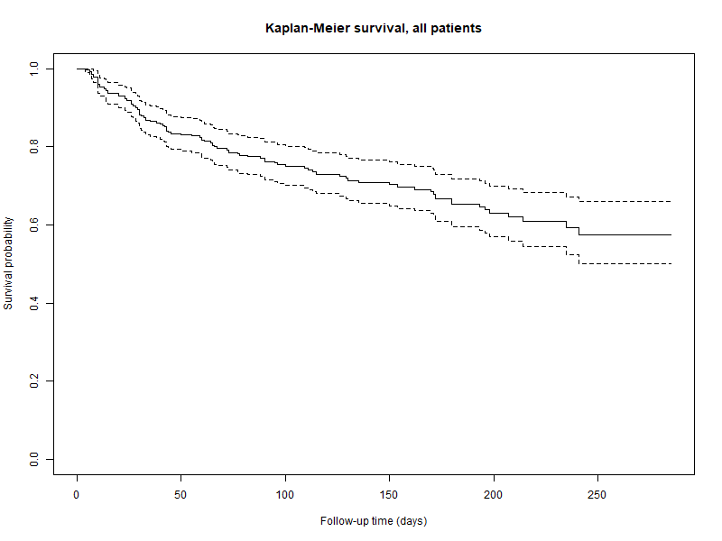
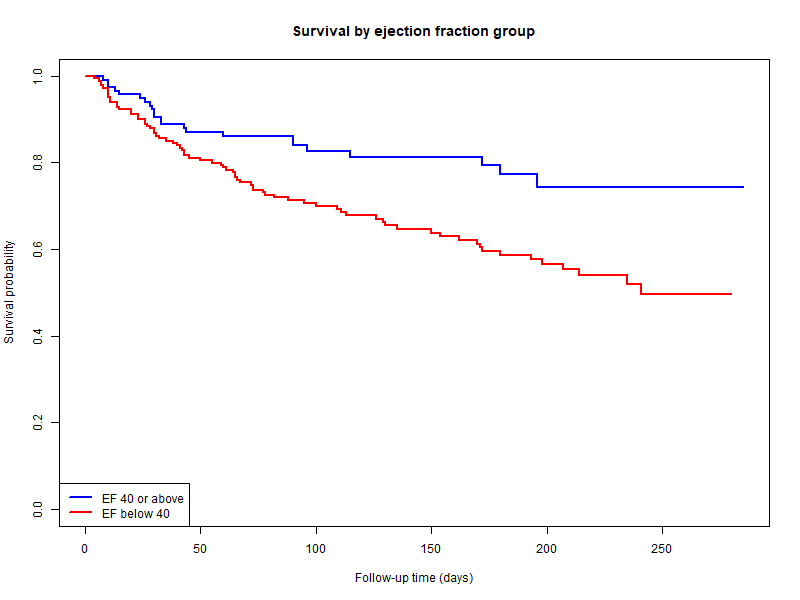

# Heart Failure Survival Analysis (R/SAS)

Survival analysis of heart-failure patients using Kaplan–Meier estimation, the log-rank test and Cox regression, done in R and repeated in SAS.

## Objective

I wanted to find out how many heart-failure patients survive over the follow-up period and which factors (like age or ejection fraction) are linked to a higher risk of death.

## Data

- **Source:** Heart Failure Clinical Records dataset (public, UCI Machine Learning Repository)
- **Patients:** 299, with 13 columns and no missing values
- **Follow-up time:** `time` (days)
- **Event:** `DEATH_EVENT` (1 = died during follow-up: 96 patients; 0 = alive at the end, called censored: 203 patients)

## Methods

1. Checked the data (size, columns, missing values, number of deaths)
2. Kaplan–Meier estimate of survival for all patients
3. Split patients by ejection fraction (below 40 and 40 or above) and compared the two groups with the log-rank test
4. Cox proportional hazards regression with 9 factors: age, ejection fraction, serum creatinine, serum sodium, anaemia, high blood pressure, diabetes, sex and smoking
5. Repeated the Kaplan–Meier estimate, log-rank test and Cox regression in SAS (PROC LIFETEST and PROC PHREG) and checked that the results match R
6. Checked the proportional hazards assumption of the Cox model (`cox.zph`)

## Results

Results below are from R. The SAS output gave the same numbers (for example log-rank chi-square 9.47, p = 0.0021, and the same hazard ratios).

### 1. Overall survival

| Day | Patients still alive |
|---|---|
| 50 | 83% |
| 100 | 75% |
| 150 | 70% |
| 200 | 63% |

The curve falls fastest in the first 50 days and ends near 0.57. The median survival is not reached, because fewer than half of the patients died.

### 2. Low vs normal ejection fraction

| Group | Patients | Deaths | Median survival |
|---|---|---|---|
| EF 40 or above | 117 | 23 | not reached |
| EF below 40 | 182 | 73 | 241 days |

Patients with an ejection fraction below 40 had worse survival than patients with 40 or above (log-rank p = 0.002). By day 200, about 57% of the low group were still alive, compared with about 74% of the other group.

### 3. Cox regression

| Factor | Hazard ratio | 95% CI | p-value |
|---|---|---|---|
| Age (per year) | 1.05 | 1.03 to 1.07 | <0.001 |
| Ejection fraction (per point) | 0.95 | 0.93 to 0.97 | <0.001 |
| Serum creatinine (per unit) | 1.37 | 1.19 to 1.57 | <0.001 |
| High blood pressure | 1.56 | 1.03 to 2.38 | 0.037 |
| Serum sodium | 0.96 | 0.92 to 1.00 | 0.074 |
| Anaemia | 1.47 | 0.97 to 2.23 | 0.068 |
| Diabetes | 1.13 | 0.73 to 1.75 | 0.573 |
| Sex | 0.84 | 0.52 to 1.35 | 0.467 |
| Smoking | 1.13 | 0.69 to 1.84 | 0.628 |

- Each extra year of age was linked to about 5% higher risk of death.
- Each extra point of ejection fraction was linked to about 5% lower risk of death.
- High blood pressure was linked to about 56% higher risk, a modest link (p = 0.037).
- Serum sodium and anaemia were borderline, and diabetes, sex and smoking showed no clear link in this data.
- Model concordance: 0.73.

## What I learned

- Censoring: 203 patients were still alive at the end of follow-up. Survival analysis uses them too, so I didn't just compare averages.
- I mixed up two numbers at first. 32% is the share of patients who died during the whole follow-up (96 of 299), and 63% is the share still alive at day 200. Now I check which group each number belongs to.
- The overall curve ends near 0.57, which is about 42% dead, not 32%, because the Kaplan–Meier method accounts for patients whose follow-up ended early.
- A hazard ratio below 1 means lower risk and above 1 means higher risk.
- These results show links, not proof of cause.
- In SAS, the censoring value goes in brackets: `time*DEATH_EVENT(0)` means 0 is censored. SAS also calls a death a "failure".
- My first SAS Cox model would have differed slightly from R, because SAS handles tied times differently by default. Adding `ties=efron` made the results match R exactly.
- The two programs gave slightly different confidence limits for the median survival (193 days in SAS and 198 in R), because they use different formulas. The median itself was the same, 241 days.

## Limitations

- Only 299 patients and 96 deaths: a small dataset gives less certain results.
- The cut-off of 40: I chose it because it is commonly used for a weak heart. A different cut-off could change the groups.
- Proportional hazards assumption: the Cox model assumes that a factor's effect on risk stays about the same over time. I tested this with `cox.zph`. The global test was fine (p = 0.376), but ejection fraction showed a mild warning (p = 0.036), so its effect may change a little over time. I did not adjust the model for this.

## Files

- `01_survival.R`: R script for the whole analysis
- `heart_failure_clinical_records_dataset.csv`: public dataset
- `output/km_overall.png`: overall survival curve
- `output/km_by_ef.png`: survival by ejection fraction
- `output/cox_results.csv`: Cox regression results
- `02_survival.sas`: SAS version (PROC LIFETEST and PROC PHREG)

## Tools

R (survival, dplyr), SAS (PROC IMPORT, PROC LIFETEST, PROC PHREG)

## Next steps

- Check the proportional hazards assumption of the Cox model
